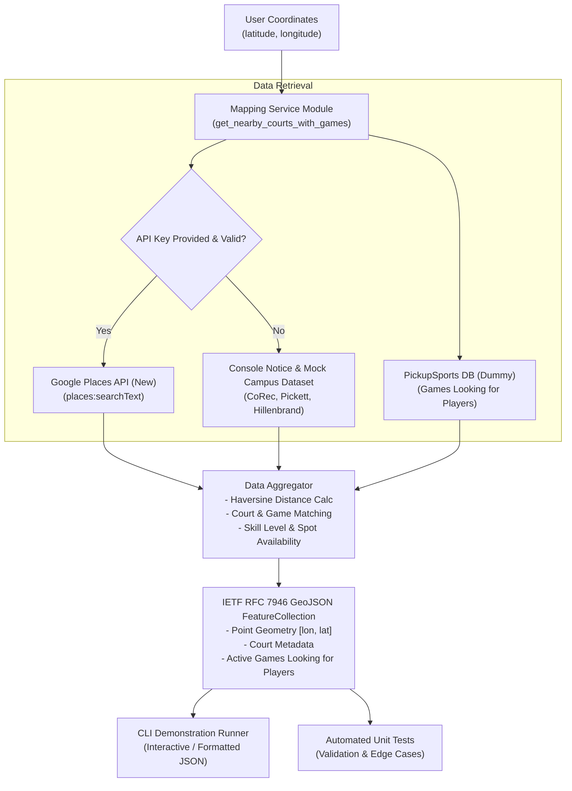

# Implementation Plan: PickupSports Mapping Subsystem Prototype

## Goal Description
Build the core **Mapping Subsystem** module for the PickupSports prototype (Team 10, ECE 49595 Fall 2026). 
As specified in **FR-02**, **NFR-06**, and Design Alternative **DA-1** (Direct Native SDK Integration with GeoJSON Endpoints), this module is responsible for:
1. Receiving a user's geographic coordinates as a `(latitude, longitude)` tuple along with a search radius.
2. Querying the **Google Places API** for physical basketball court locations around the user.
3. Merging external court location data with internal **PickupSports database records** (mocked dummy data for this prototype) representing pickup basketball games currently looking for players.
4. Outputting a standardized, clean data structure compliant with **IETF RFC 7946 (GeoJSON FeatureCollection)** where each court pin contains both spatial coordinates and rich game metadata (active games, open spots, skill level, host info) matching the Figma wireflow ("Flow 1: Find and Join a Game").
5. Providing full offline/mock capability so the module functions seamlessly with or without a live Google Places API key, along with an interactive visual verification harness on Windows to demonstrate the prototype without requiring an iOS/macOS build environment.

---

## Finalized Design Decisions

- **Git Branching:** Branch `feature/court-map-ashton` created directly off of the `prototype` branch.
- **Default Search Radius:** **2500 meters** (~25-minute walk / ~1.55 miles) for campus walkability, fully overrideable by caller.
- **Data Source Priority:** **Google Places API (New)** Text Search endpoint (`POST https://places.googleapis.com/v1/places:searchText`) is the primary data source (using `GOOGLE_PLACES_API_KEY` from environment or function argument). If the key is absent or a network call fails, the module prints a clear console notice and falls back to the Purdue campus mock dataset.
- **Scope & Harness:** Includes the core mapping service module, typed Pydantic models, dummy game database, automated unit test suite, and the CLI/functional test harness to easily observe the module functioning.

---

## Architecture & Data Flow



---

## Proposed Changes

### 1. Data Schemas & Models (`server/app/schemas/`)

#### `server/app/schemas/court.py`
Standardized models matching Team 10's SDP and dev_process specifications:
- `GameSummary`:
  - `game_id: str`
  - `start_time: str` (e.g. `"11:30 AM"`)
  - `end_time: str` (e.g. `"12:30 PM"`)
  - `skill_level: str` (`"Beginner"`, `"Mid"`, `"Advanced"`)
  - `spots_available: int`
  - `total_spots: int`
  - `host_name: str`
  - `host_show_up_rate: float` (e.g. `0.95` for 95%)
  - `rules: str` (e.g. `"1s & 2s"`)
  - `status: str` (`"open"`, `"full"`)
- `CourtProperties`:
  - `court_id: str`
  - `name: str`
  - `address: str`
  - `indoor: bool`
  - `hoop_count: int`
  - `surface: str`
  - `distance_miles: float`
  - `distance_km: float`
  - `open_now: bool`
  - `active_games_count: int`
  - `games: list[GameSummary]`
- `CourtGeoJSONFeature`:
  - `type: str = "Feature"`
  - `geometry: dict` (GeoJSON `Point` with `[longitude, latitude]`)
  - `properties: CourtProperties`
- `CourtGeoJSONFeatureCollection`:
  - `type: str = "FeatureCollection"`
  - `features: list[CourtGeoJSONFeature]`

---

### 2. Dummy PickupSports Game Database (`database/seeds/`)

#### `database/seeds/dummy_games.py`
Provides dummy games looking for players mirroring the Figma wireflow screens:
- **CoRec Court 2** (Purdue CoRec, Indoor):
  - 11:00 AM: Beginner (2.0-3.0), 4 spots open
  - 11:30 AM: Mid (3.5-4.0), 3 spots open, Host Mike R. (95% show-up rate)
  - 1:00 PM: Mid (3.5-4.5), Full (2 waiting)
  - 2:00 PM: Mid (3.5-4.0), Full
- **Pickett Park Court 1 & 2** (Outdoor):
  - 4:30 PM: Beginner, 5 spots open
  - 6:00 PM: Advanced (4.0-5.0), 2 spots open
- **Hillenbrand Courts** (Outdoor):
  - 5:00 PM: Advanced (4.0-5.0), 1 spot open
- Functions:
  - `get_dummy_games_for_court(court_name: str, min_spots_open: int = 1) -> list[GameSummary]`
  - `get_mock_campus_courts() -> list[dict]` (used for mock fallback when Places API key is not present)

---

### 3. Mapping Subsystem Module (`server/app/services/`)

#### `server/app/services/mapping_service.py`
The primary mapping module:
- Function: `get_nearby_courts_with_games(user_location: tuple[float, float], radius_meters: int = 2500, api_key: str | None = None, skill_filter: str | None = None) -> dict`
- **Haversine Distance**: Computes exact geodesic distance between `(user_lat, user_lon)` and each court.
- **Google Places API Integration**:
  - Connects to Google Places API (New) Text Search (`https://places.googleapis.com/v1/places:searchText`).
  - If `api_key` is not provided (or fails), prints:
    `"[NOTICE] Google Places API key not provided or request failed. Falling back to Purdue campus mock dataset."`
    and uses the Purdue campus dataset.
- **PickupSports DB Aggregation**:
  - For each retrieved court, queries the PickupSports dummy database for games currently looking for players (`spots_available > 0`).
  - Supports skill filtering (`"Beginner"`, `"Mid"`, `"Advanced"`, or `None` for all).
  - Sorts courts by closest distance first.
  - Returns an **IETF RFC 7946 GeoJSON FeatureCollection**.

---

### 4. CLI Demonstration Runner (`scripts/`)

#### `scripts/run_court_mapping_demo.py`
A clean command-line runner that:
- Accepts coordinates via arguments or uses Purdue campus center `(40.4282, -86.9222)` by default.
- Allows testing with live API key via `--api-key` or environment variable.
- Prints a clean summary table of nearby courts, distances, and games looking for players.
- Dumps the validated RFC 7946 GeoJSON payload.
- Tests skill level filtering (All vs. Mid vs. Advanced) directly matching the Figma flow.

---

### 5. Automated Testing Suite (`server/tests/`)

#### `server/tests/test_mapping_service.py`
Pytest/unittest automated test suite covering:
1. `test_haversine_distance_calculation`: Checks accuracy against known coordinates.
2. `test_invalid_coordinates_raise_error`: Validates bounds checking for latitude (-90 to 90) and longitude (-180 to 180).
3. `test_places_api_fallback_when_no_key`: Verifies console notice and fallback behavior.
4. `test_rfc7946_geojson_structure`: Verifies standard GeoJSON format (type, Point geometry `[lon, lat]`, properties).
5. `test_game_merging_and_spot_filtering`: Verifies that only games looking for players are aggregated when specified.
6. `test_skill_filtering`: Tests filtering by "Beginner", "Mid", and "Advanced" (Figma screen 4).
7. `test_places_api_http_mock`: Tests mock live HTTP response parsing from Google Places API.

---

## Verification Plan

### Automated Tests
```powershell
& "C:\Users\ashto\AppData\Local\Python\bin\python.exe" -m unittest discover -s server/tests -p "test_*.py" -v
```

### Manual Verification
1. Run the CLI demo with default Purdue CoRec coordinates:
   ```powershell
   & "C:\Users\ashto\AppData\Local\Python\bin\python.exe" scripts/run_court_mapping_demo.py
   ```
2. Test filtering by skill level:
   ```powershell
   & "C:\Users\ashto\AppData\Local\Python\bin\python.exe" scripts/run_court_mapping_demo.py --skill Mid
   ```
3. Test custom coordinates (e.g. Indianapolis or Pickett Park):
   ```powershell
   & "C:\Users\ashto\AppData\Local\Python\bin\python.exe" scripts/run_court_mapping_demo.py --lat 40.4258 --lon -86.9270
   ```
