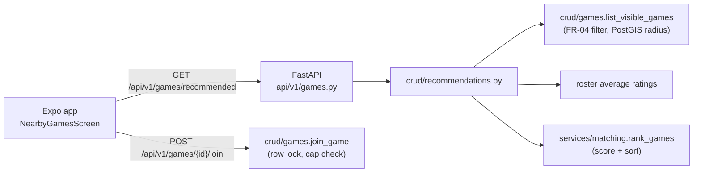

# Walkthrough: Matching Subsystem and Games API

## What it does
The app asks the backend for games near the player. The backend returns only games the player may
join (FR-04), ranked by how well they fit (FR-12). The player can narrow the list with skill chips
and join a game; the server guarantees nobody takes a spot past the player cap (FR-05).



## Ranking
Each game the filter lets through gets a score from 0 to 1:

```
score = 0.5 * skill_fit + 0.3 * distance_score + 0.2 * start_score

skill_fit      = 1 - |player rating - roster average| / skill range width
distance_score = 1 - distance / search radius
start_score    = 1 - hours until start / 168
```

- Each part is clamped to [0, 1].
- The roster average leaves out the player asking and pending requests. With nobody else on the
  roster, the middle of the skill range is used.
- All-levels games use the full 1.0-5.0 range. Ranges narrower than 1.0 count as 1.0, so a 4.0-4.0
  game doesn't divide by zero.
- Provisional players (fewer than 3 rated games) have their skill weight halved.
- Games starting more than 7 days out are dropped.
- Ties go to the earlier start, then the shorter distance, then the lower game id, so the same inputs
  always give the same order.

## API
`GET /api/v1/games/recommended`

| Query | Required | Notes |
| ----- | -------- | ----- |
| `lat`, `lng` | yes | Player location |
| `radius_mi` | no | Default 5, max 25 |
| `skill` | no | `Beginner`, `Mid`, `Advanced`, `All`. All-levels games always match. `422` otherwise |
| `court_id` | no | Only games at one court (court sheet) |

Response: `player_rating`, `is_provisional`, `radius_miles`, and `games[]`. Each game has the client's
`GameSummary` fields (`game_id`, `court_name`, `start_time`, `skill_level`, `spots_available`, `status`, ...)
plus `distance_miles`, `match_score` and a `score_breakdown`.

`POST /api/v1/games/{game_id}/join` returns `{game_id, status: "confirmed" | "pending", spots_available}`.
Errors: `401` missing/unknown `X-Dev-User`, `403` blocked or out of skill range, `404` unknown game,
`409` full or not joinable.

## Sample run
Seeded data (`python scripts/seed_database.py --date 2026-11-19`), demo player rated 4.0
(provisional), Purdue campus demo location:

| Score | Court | Start | Skill | Distance | Spots |
| ----- | ----- | ----- | ----- | -------- | ----- |
| 0.641 | Hillenbrand Hall Courts | 5:00 PM | Advanced | 0.16 mi | 1/6 |
| 0.641 | Purdue CoRec - Court 4 | 12:00 PM | Advanced | 0.06 mi | 2/10 |
| 0.630 | Purdue CoRec - Court 2 | 11:30 AM | Mid | 0.04 mi | 3/10 |
| 0.622 | Pickett Park Basketball Courts | 6:00 PM | Advanced | 0.30 mi | 2/10 |
| 0.617 | Purdue CoRec - Court 2 | 2:00 PM | Mid | 0.04 mi | Full |
| 0.616 | Purdue CoRec - Court 2 | 1:00 PM | Mid | 0.04 mi | Full |

Beginner games (2.0-3.0) are hidden because 4.0 is outside their range. On a small campus every court
is close, so skill fit decides most of the order. Joining the last Hillenbrand spot returned
`confirmed` with `spots_available: 0`.

## How to verify
```sh
export REQUIRE_DB=1
python -m pytest -q server/tests/test_matching.py server/tests/db/test_games_api.py
cd client && npm test -- --runInBand
```
`test_only_one_player_gets_the_last_spot` sends 8 joins at once for 1 open spot and checks exactly
one succeeds. `test_ranking_200_games_is_fast` keeps ranking well inside the NFR-06.1 2-second budget.

## Known limits and next steps
- Full games still appear (marked Full) because the flow offers a waitlist from there. If they crowd
  the feed, sort open games first.
- Weights are starting values. Log views and joins, then retune.
- The app uses a fixed campus location and has no Join button yet; `POST /join` is ready for it.
- Replace `X-Dev-User` with Firebase token verification.

## GenAI Usage Statement
Claude (Anthropic) generated the ranking module, API, tests, client changes and this document from the
D1 Filter-and-Score design chosen in the matching algorithm Design Alternatives exercise.
