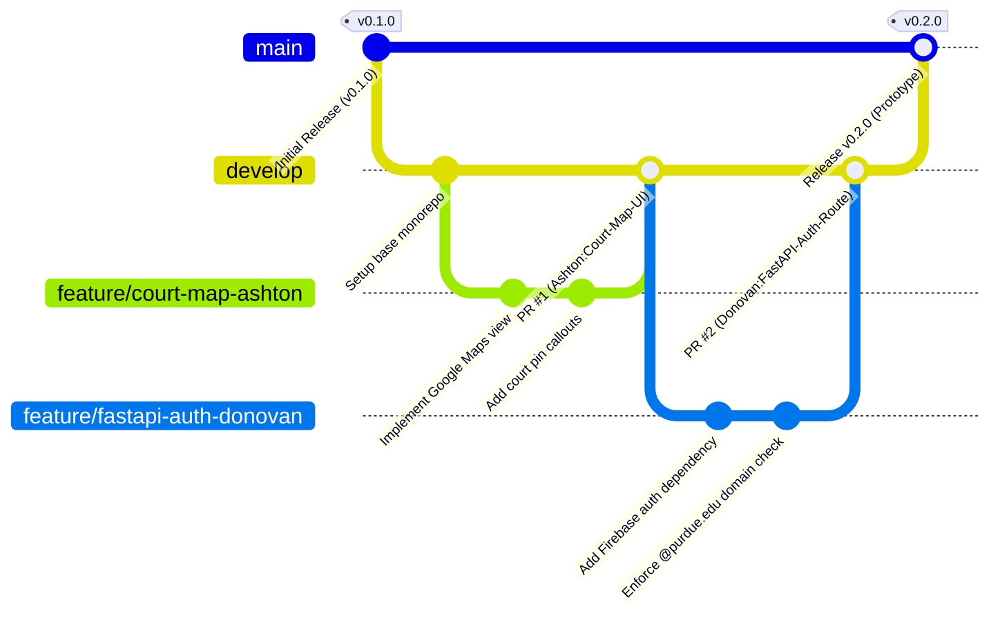
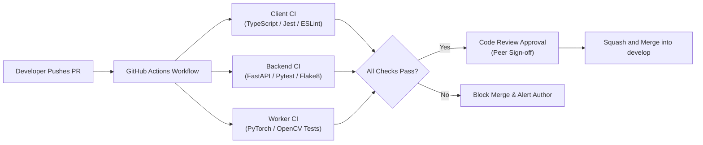

# PickupSports — Team Development Process & Repository Architecture

**Course:** ECE 49595 SD I — Section 063 (Fall 2026)  
**Team Number:** 10  
**Project:** PickupSports  
**Authors:**
- Donovan Baran (`barand@purdue.edu`)
- Ashton Reece (`reece12@purdue.edu`)
- Pranav Balaji (`balaji75@purdue.edu`)
- Soham Pandey (`pande136@purdue.edu`)

---

## 1. Document Overview

This document establishes the official software development process, repository architecture, branching and workflow model, and code review policies for Team 10 (**PickupSports**). 

The goal of this process is to provide a complete, robust, and reproducible development lifecycle tailored to our hybrid tech stack (React Native iOS client, Python FastAPI backend, Celery/Redis asynchronous computer vision worker, and PostgreSQL/PostGIS spatial database). All team members are required to follow these guidelines for prototype development, milestone deliverables, and future iterations throughout ECE 49595.

---

## 2. Repository Architecture

### 2.1 Monorepo Structural Philosophy

PickupSports utilizes a monorepo architecture. A monorepo structure guarantees that frontend client updates, backend API schemas, database migrations, and computer vision worker payloads remain synchronized across development cycles. It eliminates dependency desynchronization between services and simplifies automated Continuous Integration (CI) and local containerized testing.

### 2.2 Directory Tree Layout

```text
PickupSports/
├── .github/                               # GitHub configuration & automation
│   ├── ISSUE_TEMPLATE/                    # Bug report and feature request templates
│   │   ├── bug_report.md
│   │   └── feature_request.md
│   ├── PULL_REQUEST_TEMPLATE.md           # Standard PR review template
│   └── workflows/                         # GitHub Actions CI/CD pipelines
│       ├── backend-ci.yml                 # FastAPI linting, type checks & pytest
│       ├── client-ci.yml                  # React Native ESLint, Jest & build checks
│       └── cv-worker-ci.yml               # CV pipeline unit tests & model smoke tests
├── client/                                # React Native iOS Frontend Application
│   ├── __tests__/                         # Jest component and unit tests
│   ├── assets/                            # Static images, icons, and court overlays
│   │   ├── fonts/
│   │   └── icons/
│   ├── ios/                               # Native iOS project files (Xcode / CocoaPods)
│   ├── src/                               # Application source code (TypeScript)
│   │   ├── api/                           # Axios/Fetch clients and typed endpoints
│   │   │   ├── auth.ts                    # Firebase auth token forwarding
│   │   │   ├── games.ts                   # Game creation, joining & listing API
│   │   │   └── stats.ts                   # Box scores, shot charts & clips API
│   │   ├── components/                    # Modular, reusable UI components
│   │   │   ├── common/                    # Buttons, inputs, modal dialogs, loading states
│   │   │   ├── courts/                    # Court cards, pin callouts, filter controls
│   │   │   ├── games/                     # Roster lists, join/leave buttons, skill badges
│   │   │   └── stats/                     # Shot chart canvas, player box score table
│   │   ├── navigation/                    # React Navigation route stacks & bottom tabs
│   │   ├── screens/                       # Top-level screen views
│   │   │   ├── AuthScreen.tsx             # Purdue email login / verification view
│   │   │   ├── CourtMapScreen.tsx         # Google Maps interactive court discovery
│   │   │   ├── CreateGameScreen.tsx       # Game configuration & consent toggle
│   │   │   ├── GameDetailScreen.tsx       # Roster view, check-in, team assignments
│   │   │   ├── RecordGameScreen.tsx       # Guided baseline camera setup & court calibration
│   │   │   ├── SelfTaggingScreen.tsx      # Post-game player identification thumbnails
│   │   │   └── StatsScreen.tsx            # Shot chart, highlights & rating breakdown
│   │   ├── services/                      # Background services (resumable upload, location)
│   │   ├── types/                         # TypeScript interfaces (matching backend models)
│   │   └── utils/                         # Calibration helpers, date formatters
│   ├── app.json                           # React Native app configuration
│   ├── package.json                       # Frontend dependencies & npm scripts
│   ├── tsconfig.json                      # TypeScript strict compiler configuration
│   └── .eslintrc.js                       # ESLint and Prettier rules
├── server/                                # Python FastAPI Backend Service
│   ├── alembic/                           # Database schema migrations
│   │   ├── versions/                      # Migration revisions
│   │   └── env.py                         # Alembic migration environment
│   ├── app/                               # Backend application core
│   │   ├── api/                           # API route controllers
│   │   │   ├── v1/                        # API version 1 routers
│   │   │   │   ├── auth.py                # Purdue Firebase token validation
│   │   │   │   ├── courts.py              # Spatial PostGIS court queries (GeoJSON)
│   │   │   │   ├── games.py               # Game coordination, caps & roster locking
│   │   │   │   ├── ratings.py             # Matchmaking & skill rating updates
│   │   │   │   ├── uploads.py             # Resumable video upload endpoints
│   │   │   │   └── websockets.py          # Real-time roster and attendance sync
│   │   │   └── deps.py                    # FastAPI dependency injection (DB sessions, auth)
│   │   ├── core/                          # Global configurations and security
│   │   │   ├── config.py                  # Pydantic BaseSettings (environment variables)
│   │   │   └── security.py                # TLS configuration and token parsing
│   │   ├── crud/                          # Database CRUD operations
│   │   ├── db/                            # Database engine and session setup
│   │   │   ├── base.py                    # SQLAlchemy Base model registry
│   │   │   └── session.py                 # Async PostgreSQL engine connection pool
│   │   ├── models/                        # SQLAlchemy ORM models
│   │   │   ├── court.py                   # Court geometry, hoops, indoor/outdoor flags
│   │   │   ├── game.py                    # Game schedule, player cap, scoring rule
│   │   │   ├── player.py                  # Player profile, rating, reliability score
│   │   │   └── stat.py                    # Shot events, makes, misses, box score lines
│   │   ├── schemas/                       # Pydantic schemas (Request/Response validation)
│   │   │   ├── court.py                   # GeoJSON court feature schemas
│   │   │   ├── game.py                    # Game creation & roster payload schemas
│   │   │   └── stat.py                    # Shot coordinates & box score schemas
│   │   └── services/                      # Business logic (FCM push triggers, reliability engine)
│   ├── tests/                             # Pytest suite
│   │   ├── conftest.py                    # Test client, mock DB sessions & fixtures
│   │   ├── test_auth.py                   # Domain verification & auth testing
│   │   ├── test_courts.py                 # Spatial queries & GeoJSON validation
│   │   └── test_games.py                  # Race-condition roster locking tests
│   ├── alembic.ini                        # Alembic configuration
│   ├── Dockerfile.server                  # Multi-stage production container build
│   ├── pyproject.toml                     # Python dependencies & build system (Poetry/Pip)
│   └── requirements.txt                   # Frozen production dependencies
├── cv_pipeline/                           # Asynchronous Computer Vision Worker
│   ├── worker/                            # Celery / Redis queue worker tasks
│   │   ├── tasks.py                       # Video ingestion and job lifecycle handling
│   │   └── celery_app.py                  # Celery worker and broker setup
│   ├── pipeline/                          # Computer vision core modules
│   │   ├── calibration.py                 # Automatic rim detection & planar homography mapping
│   │   ├── detector.py                    # Ultralytics YOLO fine-tuned player/ball/rim detector
│   │   ├── tracker.py                     # ByteTrack / BoT-SORT multi-object tracking
│   │   ├── identity.py                    # Team color clustering & post-game appearance re-ID
│   │   ├── shot_detector.py               # Shot release, trajectory & make/miss event engine
│   │   └── clip_generator.py              # FFmpeg highlight extraction & video compression
│   ├── models/                            # Trained model weights & YOLO configurations
│   ├── tests/                             # Unit tests for CV geometry & tracker evaluation
│   ├── Dockerfile.worker                  # CUDA/GPU-enabled worker container definition
│   └── requirements-worker.txt            # PyTorch, TorchVision, OpenCV, Ultralytics, Celery
├── database/                              # Database Seeds & SQL Assets
│   ├── seeds/                             # Initial court dataset
│   │   └── purdue_courts.geojson          # Seeded Purdue CoRec & local West Lafayette courts
│   └── init.sql                           # PostGIS extension initialization scripts
├── docs/                                  # Project Documentation
│   ├── api/                               # OpenAPI (OAS 3.0) specifications & schema exports
│   └── semester1/                         # Semester 1 Course Deliverables
│       ├── dev_process.md                 # Development process, branching & architecture (this file)
│       ├── Project Proposal.docx          # Formal project proposal & C4 system designs
│       └── Software Development Plan.docx # Requirements, deliverables, and standards
├── scripts/                               # Developer & Deployment Automation Scripts
│   ├── setup_dev_env.ps1                  # Local environment bootstrap script (Windows/PowerShell)
│   ├── setup_dev_env.sh                   # Local environment bootstrap script (Linux/macOS)
│   └── seed_database.py                   # Script to populate local PostGIS with court seeds
├── .dockerignore                          # Docker build exclusion rules
├── .gitignore                             # Monorepo git tracking ignore file
├── docker-compose.yml                     # Local orchestration (FastAPI, PostGIS, Redis, Worker)
├── docker-compose.override.yml            # Developer local volume mounts and hot-reloading
├── LICENSE                                # Project license
└── README.md                              # Repository overview, team roster & setup guide
```

---

### 2.3 Module & Directory Descriptions

- **`.github/`**: Houses team automation, issue templates, PR review templates, and CI workflows. Automated testing ensures no breaking changes reach common integration branches.
- **`client/`**: Contains the iOS mobile application written in React Native (TypeScript). Houses view screens (Court Map, Recording, Self-Tagging, Stats), components, API clients, and native iOS configurations.
- **`server/`**: The backend RESTful and WebSocket API service powered by Python FastAPI. It implements business logic, Firebase authentication verification, PostGIS spatial queries, database transactions with row-level locking for game rosters, and Pydantic schemas.
- **`cv_pipeline/`**: The asynchronous video processing engine. Powered by a Celery task queue and Redis message broker, it executes GPU-accelerated workloads: court homography calibration, YOLO object detection, ByteTrack tracking, shot classification, and FFmpeg highlight clipping.
- **`database/`**: Houses PostgreSQL/PostGIS spatial extension initialization scripts and reviewed seed datasets (Purdue CoRec courts, Pickett Park, outdoor courts) formatted in standard GeoJSON.
- **`docs/`**: Centralized documentation repository. Stores formal course deliverables, system designs, API schemas, and architectural diagrams.
- **`scripts/`**: Convenience automation scripts for setting up local developer environments, starting Docker containers, running migrations, and seeding databases.

---

### 2.4 References to Architectural Standards & Documentation

To maintain production-grade quality, our repository architecture and interfaces conform directly to recognized industry and open engineering standards:

1. **FastAPI Application Structure & Monorepo Best Practices**:  
   Adheres to the official FastAPI modular architecture and Tiangolo’s project guidelines, cleanly separating routers, schemas, CRUD operations, and dependency injection.  
   *Reference:* [FastAPI Project Generation & Structure Guide](https://fastapi.tiangolo.com/tutorial/bigger-applications/)

2. **React Native Component Architecture**:  
   Follows standard React Native directory structures separating presentation components, navigation stacks, screen views, and typed API services.  
   *Reference:* [React Native Directory Structure Best Practices](https://reactnative.dev/docs/environment-setup)

3. **IETF RFC 7946 (The GeoJSON Format)**:  
   Standardizes geographic coordinates, court boundary polygons, and nearby court query responses between PostGIS, FastAPI, and the mobile client map.  
   *Reference:* [IETF RFC 7946](https://datatracker.ietf.org/doc/html/rfc7946)

4. **OpenAPI Specification (OAS 3.0)**:  
   FastAPI automatically generates OAS 3.0-compliant schemas from Pydantic models, ensuring contract consistency between frontend API calls and backend routes.  
   *Reference:* [OpenAPI Specification 3.0](https://www.openapis.org/)

5. **IETF RFC 8446 / RFC 9846 (Transport Layer Security - TLS 1.3)**:  
   Mandates secure data-in-transit encryption across all client-server REST and WebSocket communications.  
   *Reference:* [IETF RFC 8446](https://datatracker.ietf.org/doc/html/rfc8446)

6. **The Twelve-Factor App Methodology**:  
   Guides backend and worker process decoupling, configuration via environment variables, stateless execution, and dependency isolation.  
   *Reference:* [Twelve-Factor App Methodology](https://12factor.net/)

---

## 3. Branching & Workflow Model

### 3.1 Branching Strategy (Adapted GitHub Flow)

Team 10 uses an adapted GitHub Flow branching model centered around a shared integration branch (`develop`) and a production-ready release branch (`main`).



### 3.2 Primary Branches & Roles

| Branch Name | Role & Protection Level | Description |
| :--- | :--- | :--- |
| `main` | **Production & Release**<br>*(Protected)* | Contains stable, tested milestone releases. Direct pushes are disabled. Merges require passing all CI checks and approval from all team members. |
| `develop` | **Shared Integration**<br>*(Protected)* | The active staging branch where feature branches are integrated. All automated CI pipelines run on PRs targeting `develop`. Serves as the base for all new feature branches. |

> [!IMPORTANT]
> **Strict Repository Policy:**  
> **Do not fork the team repository to create personal development repositories.** All team members must create and maintain their feature and bugfix branches directly within the team repository (`origin`). This ensures all members can review branches, run collaborative CI checks, and inspect work without external permission hurdles.

---

### 3.3 Branch Naming Conventions

Every development branch created in the repository must strictly follow the prefix-based naming syntax established in the Team Contract:

$$\text{Format: } \langle\text{type}\rangle/\langle\text{functionality-description}\rangle-\langle\text{first-name}\rangle$$

Where:
- `type` must be one of:
  - `feature/`: For developing new functionality or components.
  - `fix/`: For resolving a defect, test failure, or bug.
  - `refactor/`: For restructuring existing code without altering external functionality.
- `functionality-description`: Short, kebab-case summary of the task.
- `first-name`: First name of the responsible author in lowercase (`ashton`, `donovan`, `pranav`, or `soham`).

#### Concrete Branch Examples:
- `feature/court-map-ui-ashton` (Ashton developing the React Native court map screen)
- `feature/firebase-auth-token-donovan` (Donovan developing backend Firebase authentication)
- `feature/celery-gpu-worker-pranav` (Pranav configuring Celery worker and Redis broker)
- `feature/roster-locking-soham` (Soham implementing atomic PostgreSQL row locking for games)
- `fix/homography-corner-distortion-ashton` (Ashton patching OpenCV court calibration math)
- `fix/jwt-expiration-handling-donovan` (Donovan fixing token expiry exception handling)
- `refactor/pydantic-schemas-soham` (Soham reorganizing API request/response models)

---

### 3.4 Feature Development Lifecycle

1. **Sync with Upstream:**
   ```bash
   git checkout develop
   git pull origin develop
   ```
2. **Create Feature Branch:**
   ```bash
   git checkout -b feature/<task-name>-<firstname>
   ```
3. **Local Development & Incremental Commits:**
   Make atomic, well-documented commits describing what and why changes were made:
   ```bash
   git commit -m "Add PostGIS spatial query for nearby courts within 5km radius"
   ```
4. **Push Branch to Origin:**
   ```bash
   git push -u origin feature/<task-name>-<firstname>
   ```
5. **Open Pull Request:** Target `develop` using the standardized PR template and naming conventions.

---

## 4. Code Development & Review Policy

### 4.1 Pull Request (PR) Policy & Naming

Every code contribution—regardless of size—must be merged via a GitHub Pull Request targeting the `develop` branch. Direct commits to `develop` and `main` are strictly forbidden by GitHub branch protection rules.

#### PR Title Naming Syntax
In accordance with the Team Contract, all Pull Request titles must follow the format:

$$\text{Format: } \langle\text{First Name}\rangle:\langle\text{Task Name}\rangle$$

**Examples:**
- `Ashton:Court-Map-UI-and-Pin-Interactions`
- `Donovan:FastAPI-Firebase-Authentication-Dependency`
- `Pranav:Celery-Task-Queue-and-Docker-Setup`
- `Soham:PostgreSQL-Game-Roster-Atomic-Transactions`

#### Pull Request Description Template
Every PR must include a completed description adhering to the following structure:
```markdown
## Description
A concise summary of the functional changes introduced in this PR.

## Related Issues / Deliverables
Closes #<issue_number> (or links to Deliverable DEL-XX / Requirement SYS-XX)

## Key Changes
- [x] Implemented ...
- [x] Added unit tests for ...
- [x] Updated API schema docs for ...

## Verification & Testing Performed
- [x] Local unit tests passed (`pytest` / `npm test`)
- [x] Tested against local PostgreSQL/PostGIS container
- [x] Verified in iOS simulator / Postman

## Reviewer Checklist
- [ ] Code follows formatting standards (ESLint / Black / Flake8)
- [ ] No exposed secrets or hardcoded credentials
- [ ] Conforms to security & privacy guidelines
```

---

### 4.2 Review Frequency & Approval Rules

- **Review Turnaround Time:** In accordance with the Team Contract, all team members must review assigned pull requests within **5 days** of submission. Urgent blockers flagged in the team chat are reviewed within **24 hours**.
- **Required Approvals:** 
  - Pull requests merging from `develop` into `main` (milestone releases) require approval from **all team members**
- **Constructive Review Criteria:**
  - **Correctness:** Does the code satisfy the functional requirement without side effects?
  - **Testing:** Are edge cases covered with automated tests?
  - **Performance & Security:** Are database queries indexed? Are authentication tokens verified? Is TLS enforced? Are sensitive credentials absent?
  - **Documentation:** Are interfaces, schemas, and complex algorithms commented and self-documenting?

---

### 4.3 Automated Continuous Integration (CI) Checks

Every PR triggers automated GitHub Actions workflows. A PR cannot be merged unless all checks pass:



#### Automated Pipeline Steps:
1. **Frontend (`client-ci.yml`):**
   - Lints TypeScript code using `eslint` and verifies formatting with `prettier`.
   - Runs TypeScript compiler check (`tsc --noEmit`).
   - Executes unit tests with `jest` (components, formatting utilities, API adapters).
2. **Backend (`backend-ci.yml`):**
   - Checks code formatting and syntax with `flake8`, `black --check`, and `ruff`.
   - Runs static type checks with `mypy`.
   - Boots a temporary PostgreSQL + PostGIS test container.
   - Executes the `pytest` suite against test endpoints, auth verification, and spatial queries.
3. **Computer Vision Worker (`cv-worker-ci.yml`):**
   - Validates YOLO model loading and pipeline integration tests using sample synthetic frames.
   - Verifies homography calculation and coordinate mapping math.

---

### 4.4 Merge Strategy & Repository Maintenance

- **Merge Method:** Pull requests are merged using **Squash and Merge**. This condenses intermediate work-in-progress commits into a single, clean commit on `develop` or `main` while preserving descriptive PR titles and descriptions.
- **Branch Deletion:** Feature and bugfix branches must be deleted immediately after merging to prevent stale branch accumulation.
- **Tagging Releases:** Every release merged into `main` must be tagged using semantic versioning (`v0.1.0-prototype`, `v1.0.0-mvp`, etc.).

---

## 5. Team Coordination, Tooling & Conflict Resolution

### 5.1 Communication Protocols & SLA

| Channel | Purpose | SLA / Target Response Time |
| :--- | :--- | :--- |
| **iMessage / RCS Group Chat** | Day-to-day coordination, urgent alerts, quick updates | Within **5 hours** |
| **Discord** | Virtual team meetings, screensharing, non-code media sharing | Scheduled / As needed |
| **GitHub PRs & Issues** | Code reviews, technical discussions, architectural debates | Within **5 days** |

### 5.2 Conflict Resolution Procedure

If technical disagreements or interpersonal issues arise during the development process, the team follows the staged resolution protocol from the Team Contract:

1. **Step 1 (Direct 1-on-1):** The two involved team members meet one-on-one within 24 hours to review trade-offs, examine technical benchmarks, and seek an objective compromise.
2. **Step 2 (Full Team Consensus):** If unresolved, the issue is brought before all four team members during a Discord call for a team discussion and majority vote.
3. **Step 3 (Course Staff Escalation):** If a consensus cannot be reached within one calendar week, or if the issue impacts project scope or academic integrity, the team immediately contacts course instructors and TAs for binding guidance.

---

## 6. GenAI Usage Statement

Generative AI (Gemini 3.8 Flash via Antigravity) was used in the authoring of this development process document. Specifically, GenAI assisted in synthesizing the Team Contract requirements, Project Proposal specifications, and Software Development Plan architecture into a unified Markdown document.